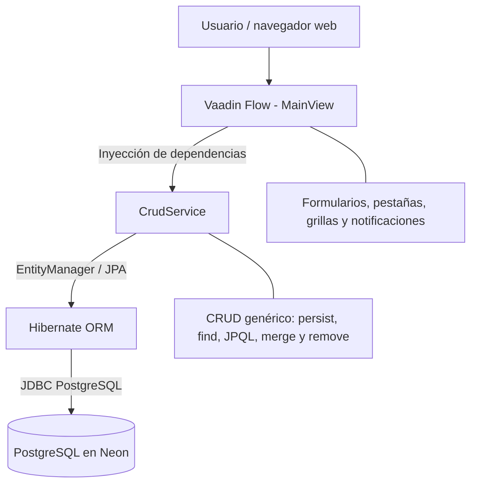

# Facturate

<p align="center">
  <strong>Sistema académico de gestión de productos, clientes, ventas y recaudo</strong><br>
  Proyecto Integrador · Grupo 4 · CESDE · 2026-2
</p>

<p align="center">
  
  
  
  
  
</p>

**Repositorio:** [julianz-dev/proyecto-integrador-b1-final-2026-2-g4](https://github.com/julianz-dev/proyecto-integrador-b1-final-2026-2-g4)

---

## Tabla de contenido

- [Resumen ejecutivo](#resumen-ejecutivo)
- [Funcionalidades](#funcionalidades)
- [Arquitectura](#arquitectura)
- [Modelo de datos](#modelo-de-datos)
- [Stack tecnológico](#stack-tecnológico)
- [Estructura del proyecto](#estructura-del-proyecto)
- [Requisitos previos](#requisitos-previos)
- [Configuración del entorno](#configuración-del-entorno)
- [Configuración de la base de datos](#configuración-de-la-base-de-datos)
- [Ejecución local](#ejecución-local)
- [Compilación y empaquetado](#compilación-y-empaquetado)
- [Flujo de trabajo y control de versiones](#flujo-de-trabajo-y-control-de-versiones)
- [Pruebas y estado de validación](#pruebas-y-estado-de-validación)
- [Licencia y créditos](#licencia-y-créditos)

---

## Resumen ejecutivo

**Facturate** es una aplicación web académica para administrar los datos principales de una operación comercial y simular el flujo de una venta. El alcance implementado se concentra en cuatro entidades: **Productos**, **Clientes**, **Ventas** y **Detalles de venta**.

La aplicación ofrece formularios de mantenimiento y grillas de consulta para ejecutar las operaciones CRUD (*Create, Read, Update, Delete*). La información se persiste en PostgreSQL; la interfaz se construye en Java con Vaadin Flow y la persistencia se realiza mediante Jakarta Persistence (JPA), Hibernate y un servicio genérico basado en `EntityManager`.

El valor del prototipo está en centralizar el catálogo, los clientes y los registros de ventas, mantener identificadores generados por la base de datos y hacer cumplir las relaciones principales entre clientes, ventas, productos y detalles.

> **Alcance académico:** el código revisado implementa CRUD y una simulación de ventas. No debe interpretarse como una solución de facturación electrónica certificada: el proyecto no acredita integración con la DIAN, generación de factura electrónica, pasarela de pagos, autenticación/autorización de usuarios ni sincronización offline.

## Funcionalidades

| Módulo | Funcionalidad implementada |
|---|---|
| **Productos** | Crear, consultar, actualizar y eliminar productos; administrar código, nombre, descripción, precio, categoría, tipo de ítem y banderas de inventario/estado. |
| **Clientes** | Crear, consultar, actualizar y eliminar clientes; administrar identificación, razón social, negocio y estados del registro. |
| **Ventas** | Crear, consultar, actualizar y eliminar ventas; generar `uuidLocal` y `fechaVenta` al crear el registro. |
| **Detalles de venta** | Crear, consultar, actualizar y eliminar las líneas que relacionan una venta con un producto. |
| **Grillas** | Mostrar registros y cargar sus datos en el formulario al seleccionar una fila. |
| **Controles de formulario** | Campos de solo lectura para identificadores generados; campos numéricos para IDs; `TextArea` para la descripción de productos; selectores para valores booleanos y tipo de documento. |
| **Validaciones puntuales** | Comprobar que se seleccionen los valores obligatorios de los controles `Select` antes de crear o actualizar productos y clientes. |

En el selector de tipo de documento de clientes se manejan los códigos `CC`, `CE`, `NIT` y `PAS`. Los campos booleanos se presentan visualmente como **SI/NO**.

## Arquitectura

El proyecto utiliza una arquitectura por capas simplificada. La vista Vaadin recibe las acciones del usuario, el servicio genérico ejecuta las operaciones de persistencia y JPA/Hibernate interactúa con PostgreSQL.



### Componentes principales

- **`Application.java`**: punto de entrada de Spring Boot. Configura el shell de Vaadin, el tema Aura, la hoja de estilos y la comunicación Push.
- **`MainView.java`**: vista principal (`@Route("")`). Organiza los cuatro módulos en un `TabSheet` y gestiona los formularios, grillas, eventos y notificaciones.
- **`CrudService.java`**: servicio Spring transaccional que utiliza `EntityManager` para guardar, buscar, listar, actualizar y eliminar entidades. No se crean interfaces Repository independientes para cada entidad.
- **`model/`**: contiene las cuatro entidades JPA que representan las tablas principales.
- **PostgreSQL / Neon**: almacena los registros y aplica las restricciones de integridad referencial configuradas en el esquema `public`.

## Modelo de datos

El siguiente diagrama representa las cuatro entidades JPA incluidas en el proyecto y las tres claves foráneas verificadas en Neon. Los tipos que aparecen en las tablas del diagrama corresponden a los tipos Java de las entidades.

<p align="center">
  
</p>

### Entidades y relaciones

| Tabla | Clave primaria | Relaciones principales |
|---|---|---|
| `clientes` | `cliente_id` | Un cliente puede estar asociado a muchas ventas. |
| `productos` | `producto_id` | Un producto puede aparecer en muchos detalles de venta. |
| `ventas` | `venta_id` | Cada venta referencia un cliente y puede contener muchos detalles. |
| `detalles_venta` | `detalle_venta_id` | Cada detalle referencia una venta y un producto. |

Las siguientes restricciones `FOREIGN KEY` fueron creadas y verificadas en la base Neon `neondb`, esquema `public`:

| Restricción | Columna de origen | Referencia |
|---|---|---|
| `fk_ventas_clientes` | `ventas.cliente_id` | `clientes.cliente_id` |
| `fk_detalles_venta_ventas` | `detalles_venta.venta_id` | `ventas.venta_id` |
| `fk_detalles_venta_productos` | `detalles_venta.producto_id` | `productos.producto_id` |

**Nota de implementación:** las entidades Java representan los IDs relacionados como atributos escalares (`Long` o `long`); en el código revisado no están declaradas asociaciones JPA `@ManyToOne`/`@OneToMany`. Las claves foráneas anteriores están definidas en PostgreSQL. Los campos `negocio_id`, `categoria_id`, `tipo_item_id`, `usuario_id` y `origen_id` se manejan como IDs escalares y no forman parte de las tres relaciones FK documentadas en este alcance.

> El SVG `modelo_er_facturate_simulador_ventas.svg` que acompaña al código fuente corresponde a un diagrama anterior y no coincide completamente con las entidades JPA actuales. Para la entrega vigente, utiliza el PNG actualizado enlazado en esta sección.

### SQL para configurar las claves foráneas en una base nueva

Hibernate puede crear o actualizar las tablas a partir de las entidades, pero las relaciones anteriores se agregaron manualmente en Neon. Si se prepara una base nueva, ejecuta este bloque **después de que existan las cuatro tablas y se hayan validado los datos**. El bloque comprueba el nombre y la tabla de cada restricción para no intentar crearla dos veces.

```sql
DO $$
BEGIN
    IF NOT EXISTS (
        SELECT 1 FROM pg_constraint
        WHERE conname = 'fk_ventas_clientes'
          AND conrelid = 'public.ventas'::regclass
    ) THEN
        ALTER TABLE public.ventas
        ADD CONSTRAINT fk_ventas_clientes
        FOREIGN KEY (cliente_id)
        REFERENCES public.clientes (cliente_id);
    END IF;

    IF NOT EXISTS (
        SELECT 1 FROM pg_constraint
        WHERE conname = 'fk_detalles_venta_ventas'
          AND conrelid = 'public.detalles_venta'::regclass
    ) THEN
        ALTER TABLE public.detalles_venta
        ADD CONSTRAINT fk_detalles_venta_ventas
        FOREIGN KEY (venta_id)
        REFERENCES public.ventas (venta_id);
    END IF;

    IF NOT EXISTS (
        SELECT 1 FROM pg_constraint
        WHERE conname = 'fk_detalles_venta_productos'
          AND conrelid = 'public.detalles_venta'::regclass
    ) THEN
        ALTER TABLE public.detalles_venta
        ADD CONSTRAINT fk_detalles_venta_productos
        FOREIGN KEY (producto_id)
        REFERENCES public.productos (producto_id);
    END IF;
END $$;
```

## Stack tecnológico

Las versiones principales se obtuvieron del `pom.xml` del proyecto. Las versiones de dependencias administradas por Spring Boot no se fijan individualmente en el POM.

| Tecnología | Versión / configuración | Uso |
|---|---|---|
| Java JDK | 25 (`java.version` en Maven) | Lenguaje y entorno de ejecución. |
| Spring Boot | 4.1.1 | Arranque, configuración e inyección de dependencias. |
| Vaadin | 25.3.0 | Interfaz web server-side con Vaadin Flow. |
| Spring Data JPA | Gestionada por Spring Boot 4.1.1 | Integración de persistencia JPA. |
| Hibernate ORM | Gestionada por Spring Boot; el log de ejecución compartido reportó 7.4.5.Final | Implementación ORM de JPA. |
| PostgreSQL JDBC | Versión gestionada por Spring Boot | Conectividad JDBC con PostgreSQL. |
| PostgreSQL | Instancia Neon; el log de ejecución compartido reportó 18.6 | Base de datos relacional. |
| Maven | Según instalación local | Gestión de dependencias, ejecución y empaquetado. |
| Docker | Dockerfile incluido | Construcción de imagen de contenedor; requiere completar/verificar el Maven Wrapper. |

### Dependencias principales del `pom.xml`

- `com.vaadin:vaadin`
- `com.vaadin:vaadin-spring-boot-starter`
- `com.vaadin:vaadin-dev` (opcional)
- `org.springframework.boot:spring-boot-starter-data-jpa`
- `org.postgresql:postgresql` (runtime)
- `org.springframework.boot:spring-boot-starter-test` (test)
- `com.vaadin:browserless-test-spring` (test)

## Estructura del proyecto

```text
proyecto-integrador-b1-final-2026-2-g4/
├── docs/
│   ├── 00_INDICE_Y_ARQUITECTURA.md
│   ├── 01_CONFIGURACION_INICIAL_Y_POM.md
│   ├── 02_CONEXION_POSTGRESQL_Y_PROPERTIES.md
│   ├── 03_ENTIDADES_MODELO_JPA.md
│   ├── 04_SERVICIO_CRUD_CON_HIBERNATE.md
│   ├── 05_INTERFAZ_GRAFICA_MAINVIEW.md
│   ├── 06_EJECUCION_Y_PRUEBAS.md
│   ├── 07_GUIA_ADAPTACION_NUEVAS_IDEAS_DE_NEGOCIO.md
│   └── images/
│       └── modelo-er-facturate.png
├── src/
│   └── main/
│       ├── java/com/example/
│       │   ├── Application.java
│       │   ├── MainView.java
│       │   ├── model/
│       │   │   ├── Clientes.java
│       │   │   ├── Productos.java
│       │   │   ├── Ventas.java
│       │   │   └── DetallesVenta.java
│       │   └── service/
│       │       └── CrudService.java
│       └── resources/
│           ├── application.properties
│           └── META-INF/resources/styles.css
├── Dockerfile
├── LICENSE.md
├── pom.xml
├── mvnw
├── mvnw.cmd
└── README.md
```

Los archivos Markdown heredados de `docs/` incluyen material de guía y ejemplos del scaffold inicial; algunos apartados conservan referencias a entidades o escenarios anteriores. Deben revisarse antes de considerarlos documentación normativa del sistema actual. Para el modelo vigente, la referencia es el código de `model/` y el diagrama ER incluido en este README.

## Requisitos previos

1. **JDK 25** instalado y disponible en `PATH` (`java -version`).
2. **Apache Maven** instalado localmente (`mvn -version`).
3. Acceso a una base **PostgreSQL**. El entorno de desarrollo de referencia utiliza Neon.
4. **Git** para clonar el repositorio y trabajar con ramas.
5. Navegador web moderno para acceder a la interfaz.

> **Maven Wrapper:** el archivo fuente revisado incluye `mvnw` y `mvnw.cmd`, pero no incluye `.mvn/wrapper/maven-wrapper.properties`. Por eso, las instrucciones de esta guía utilizan Maven instalado (`mvn`). Para ejecutar `mvnw` debe incorporarse la configuración faltante del wrapper.

## Configuración del entorno

### 1. Clonar el repositorio

```bash
git clone https://github.com/julianz-dev/proyecto-integrador-b1-final-2026-2-g4.git
cd proyecto-integrador-b1-final-2026-2-g4
```

### 2. Configurar las variables de conexión

La aplicación obtiene los parámetros de conexión desde estas variables:

| Variable | Descripción |
|---|---|
| `DB_URL` | URL JDBC de PostgreSQL. |
| `DB_USERNAME` | Usuario de la base de datos. |
| `DB_PASSWORD` | Contraseña del usuario. |
| `PORT` | Puerto HTTP de la aplicación; si no se define, utiliza `8080`. |

Ejemplo para **PowerShell** (reemplaza los valores de ejemplo por los datos de tu propia instancia Neon):

```powershell
$env:DB_URL = "jdbc:postgresql://<HOST_NEON>/<BASE_DATOS>?sslmode=require&channel_binding=require"
$env:DB_USERNAME = "<USUARIO_NEON>"
$env:DB_PASSWORD = "<CONTRASENA_NEON>"
$env:PORT = "8080"
```

Ejemplo para **Linux/macOS**:

```bash
export DB_URL='jdbc:postgresql://<HOST_NEON>/<BASE_DATOS>?sslmode=require&channel_binding=require'
export DB_USERNAME='<USUARIO_NEON>'
export DB_PASSWORD='<CONTRASENA_NEON>'
export PORT='8080'
```

En `src/main/resources/application.properties`, la configuración segura recomendada es requerir las variables en lugar de mantener credenciales como valores predeterminados:

```properties
server.port=${PORT:8080}
spring.datasource.url=${DB_URL}
spring.datasource.username=${DB_USERNAME}
spring.datasource.password=${DB_PASSWORD}
spring.datasource.driver-class-name=org.postgresql.Driver
```

**Seguridad obligatoria antes de continuar:** el ZIP revisado contiene una contraseña de Neon escrita directamente como valor alternativo de `spring.datasource.password`, y el archivo `application.properties` de la rama pública `main` también mantiene un valor predeterminado para `DB_PASSWORD`. No se reproduce aquí. Rota la contraseña de Neon, reemplaza la propiedad por `${DB_PASSWORD}` sin valor alternativo y publica la corrección. Como el valor ya llegó a un repositorio público, considera que pudo quedar expuesto en el historial: cambiar el archivo actual no invalida la credencial ni elimina versiones anteriores. No guardes credenciales en el README ni en archivos versionados. Añade los archivos locales de secretos (por ejemplo `.env`) a `.gitignore` y conserva únicamente un `.env.example` sin valores reales.

## Configuración de la base de datos

1. Crea o selecciona el proyecto y la base de datos PostgreSQL en Neon.
2. Utiliza el esquema `public` y configura `DB_URL`, `DB_USERNAME` y `DB_PASSWORD`.
3. Al iniciar la aplicación, Hibernate utiliza `spring.jpa.hibernate.ddl-auto=update` para crear o actualizar las tablas mapeadas por las entidades JPA.
4. Comprueba que existan `clientes`, `productos`, `ventas` y `detalles_venta`.
5. Verifica las tres claves foráneas descritas en [Modelo de datos](#modelo-de-datos). En una base nueva, aplica el bloque SQL de esa sección después de crear las tablas y validar los datos.

La configuración actual también tiene `spring.jpa.show-sql=true` y `spring.jpa.properties.hibernate.format_sql=true`, por lo que las consultas SQL generadas por Hibernate se muestran en la consola durante el desarrollo.

> **Nota de entorno:** `ddl-auto=update` es práctico durante el desarrollo académico, pero no sustituye un sistema de migraciones versionadas para producción. Antes de cambiarlo o ejecutar migraciones, realiza una copia de seguridad de la base de datos.

## Ejecución local

Desde la carpeta raíz del proyecto, con las variables de entorno configuradas, ejecuta:

```bash
mvn spring-boot:run
```

Cuando Spring Boot y Vaadin terminen de iniciar, abre:

[http://localhost:8080/](http://localhost:8080/)

Si configuraste un valor distinto en `PORT`, utiliza ese puerto en la URL.

La clase principal es `com.example.Application`. También puedes ejecutarla desde un IDE compatible con Maven y Java 25.

## Compilación y empaquetado

Para limpiar y compilar el proyecto:

```bash
mvn clean package
```

El artefacto Spring Boot esperado por la configuración Maven es:

```text
target/app-1.0-SNAPSHOT.jar
```

Para ejecutar el JAR empaquetado:

```bash
java -jar target/app-1.0-SNAPSHOT.jar
```

El `Dockerfile` del repositorio utiliza Java 25 y ejecuta `./mvnw` durante la construcción. Debido a que la configuración `.mvn/wrapper` no está incluida en el ZIP revisado, la construcción Docker debe considerarse pendiente de validar hasta completar el Maven Wrapper.

## Flujo de trabajo y control de versiones

El repositorio utiliza Git y GitHub, con `main` como rama de integración. Para reducir conflictos, se recomienda trabajar los cambios funcionales en ramas separadas y mantener `main` actualizado.

Flujo sugerido:

```bash
# Actualizar la rama principal
git checkout main
git pull origin main

# Crear una rama para el cambio
git checkout -b feat/nombre-del-cambio

# Revisar, preparar y confirmar cambios
git status
git add <archivos>
git commit -m "feat: describe el cambio"

# Publicar la rama
git push -u origin feat/nombre-del-cambio
```

Se utiliza la convención **Conventional Commits** para que los mensajes describan la intención del cambio:

| Prefijo | Uso |
|---|---|
| `feat:` | Nueva funcionalidad. |
| `fix:` | Corrección de un error. |
| `docs:` | Documentación. |
| `refactor:` | Reestructuración sin cambiar el comportamiento esperado. |
| `test:` | Incorporación o ajuste de pruebas. |
| `chore:` | Mantenimiento y configuración. |

Antes de integrar una rama, revisa los cambios, confirma que el proyecto compile y prueba los flujos CRUD afectados.

## Pruebas y estado de validación

La revisión del código confirma que el POM incluye dependencias para pruebas (`spring-boot-starter-test` y `browserless-test-spring`). Sin embargo, el ZIP revisado no contiene archivos de prueba dentro de `src/test`; por tanto, este README no declara una suite automatizada como existente ni afirma cobertura de pruebas.

Validaciones funcionales recomendadas para cada entrega:

- Crear un registro y confirmar que PostgreSQL genere su clave primaria.
- Consultar por ID y seleccionar una fila de la grilla.
- Actualizar campos y comprobar el resultado en la grilla y en Neon.
- Eliminar registros y confirmar que las claves foráneas impidan borrar registros que tengan dependencias.
- Comprobar que los IDs referenciados existan y que los campos obligatorios estén diligenciados.
- Probar el comportamiento de UUID y fecha automática al crear una venta.

## Licencia y créditos

El repositorio incluye [`LICENSE.md`](LICENSE.md), cuyo texto corresponde a **The Unlicense**, una dedicación al dominio público.

**Institución:** CESDE  
**Asignatura / entrega:** Proyecto Integrador · 2026-2  
**Equipo:** Grupo 4

Los archivos entregados para esta revisión no contienen un listado verificable de todos los integrantes ni una asignación formal de responsabilidades. Completar la siguiente tabla con los datos acordados por el equipo antes de la entrega académica:

| Integrante | Rol asignado | Responsabilidades |
|---|---|---|
| Por completar | Por completar | Por completar |
| Por completar | Por completar | Por completar |
| Por completar | Por completar | Por completar |
| Por completar | Por completar | Por completar |

---

<p align="center">
  <sub>Facturate · Proyecto académico de simulación de ventas y recaudo · Grupo 4 · CESDE 2026-2</sub>
</p>
